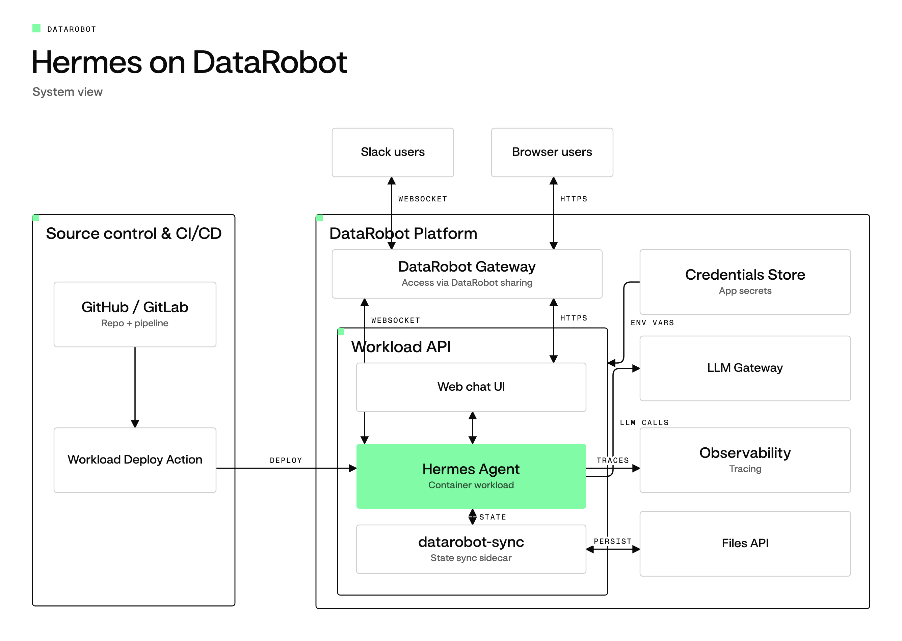

# Hermes Agent on DataRobot

<picture>
  <source media="(prefers-color-scheme: dark)" srcset="docs/architecture-dark.png">
  
</picture>

> [!NOTE]
> Experimental and community maintained. Not an officially supported DataRobot product, and provided as is with no support commitment.

https://github.com/user-attachments/assets/1fc91835-d00b-4ea6-b28d-d05a09798235

Autonomy where it pays off. Control where it counts.

A long-running, autonomous agent remembers last Tuesday and acts while you're away. That takes controls a one-shot pipeline never needed. This repository runs [Hermes Agent](https://github.com/NousResearch/hermes-agent), an open, long-running agent, as a DataRobot workload, inside a perimeter that supplies them. Read the thinking behind it in [Autonomous Agents with Control](https://labs.datarobot.com/blog/persistent-autonomous-agents/).

You get a Hermes Agent with a web UI on the workload's endpoint, an optional Slack bot, and tools for coding, git and working with DataRobot itself, on DataRobot's LLM gateway.

A [workload](https://docs.datarobot.com/en/docs/workload-api/create-workloads/workload-concepts.html) is how DataRobot runs a container: a stable identity and endpoint, with governance and monitoring around the running instances. The [Workload API documentation](https://docs.datarobot.com/en/docs/workload-api/index.html) covers the full model.

Hermes Agent is a project of Nous Research. This repository is not affiliated with or endorsed by Nous Research.

## The controls

Built on the Agent Workforce Platform, in three groups.

**Build efficiently anywhere.** Hermes Agent runs unmodified: bring any framework. It calls models through the DataRobot LLM gateway, so there are no provider API keys to manage. The toolchain in the image is pinned and checksummed.

**Operate consistently everywhere.** The agent runs as a workload with a stable endpoint and a `/health` readiness probe. Sessions and memory survive restarts: [datarobot-sync](https://datarobot-labs.github.io/datarobot-sync/) restores them on boot and uploads them on a timer and at shutdown, keeping earlier generations you can inspect and roll back to. See [Persisting state across restarts](docs/ARCHITECTURE.md#persisting-state-across-restarts).

**Govern from day one.**

- *Credentials.* Secrets live as DataRobot credentials, never in the image or the repo. The workload gets a key of its own from the platform, not yours. On GitHub it acts as its own GitHub App, with installation tokens that last about an hour, instead of a personal token.
- *Tracing.* OpenTelemetry traces of model calls, tool calls and API requests go to DataRobot. See [Exporting traces to DataRobot](docs/ARCHITECTURE.md#exporting-traces-to-datarobot).
- *Access.* The web UI sits behind the DataRobot login, so the platform decides who gets in and there is no second user database. Slack is gated separately, by an allow-list of user IDs that blocks everyone when it's empty. Both reach the same agent and the same memory.

## Deploy your own

You need a DataRobot account with [Workloads](https://docs.datarobot.com/en/docs/workload-api/index.html) enabled, and the DataRobot CLI (`dr`) v0.14.1 or later, logged in to that install:

```sh
brew install datarobot-oss/taps/dr-cli          # or: curl -fsSL https://cli.datarobot.com/install | sh
dr auth login                                   # e.g. dr auth login https://staging.datarobot.com
```

Then, from a clone of this repo:

```sh
dr start
dr workload up
```

**`dr start`** sets up the clone, and is safe to re-run:

- checks your `dr` version and installs [Task](https://taskfile.dev) if it's missing;
- writes `.env`, asking only for what's missing: whether to connect Slack, and
  if so its tokens. Your DataRobot URL and API token come from your `dr` login;
- writes `.datarobot.yaml`, the deploy manifest: built from the Dockerfile,
  1 CPU / 2 GB, a readiness probe on `/health`, and the secrets in `.env`
  stored as DataRobot credentials rather than in the file. Your own API token
  isn't one of them: the workload gets a key of its own from the platform.

**`dr workload up`** uploads the repo, DataRobot builds the image (a few
minutes the first time) and starts the workload, and later deploys roll out
only what changed. Add `--dry-run` to preview a deploy. `dr run deploy` is the
same deploy, run through this repo's task, which first refuses a manifest that
would give the workload your own token.

### Draft or permanent

A first `dr workload up` creates a draft workload. DataRobot stops a draft workload after 8 hours, whether or not anyone uses it. Choose which you want:

- **Try it.** Run `dr workload up` as shown. The workload stops by itself after 8 hours.
- **Keep it.** Add `--promote`, which locks the version and makes the workload permanent: `dr workload up --promote`, or `dr run deploy -- --promote` through this repo's task. To make a draft that is already running permanent, run `dr workload promote`.

Promoting is one-way. The artifact stays locked, and DataRobot refuses to delete a locked artifact, so a later `--purge` keeps it. [Start over](docs/TROUBLESHOOTING.md#start-over) covers that case. The deploy from CI, described in [Deploying from CI](#deploying-from-ci), promotes by default.

To open the web UI, open the URL `dr workload endpoint` prints, with its
trailing slash. To check that everything is healthy:

```sh
dr run doctor
```

On an install other than `app.datarobot.com`, also see
[TROUBLESHOOTING.md](docs/TROUBLESHOOTING.md#a-non-app-install-still-reaches-appdatarobotcom).
Each deployment needs its own name: to deploy a second copy, run
`WORKLOAD_NAME=hermes-<something> dr start` in a fresh clone.

## Deploying from CI

A clone can roll out its deployment on every push to `main`. The workflow [`deploy.yml`](.github/workflows/deploy.yml) runs the [`workload-deploy-github`](https://github.com/datarobot-oss/workload-deploy-github) action, which runs `dr workload up` for the workload that `.datarobot.yaml` names. The workflow is off until you turn it on.

CI never creates a workload. The first deploy runs on your machine, and the manifest it writes holds the workload ID that CI rolls from then on.

1. Run the first deploy on your machine with `dr start` and `dr workload up`, as described in [Deploy your own](#deploy-your-own).
2. Commit the manifest to a private repository. It holds your credential IDs and Slack channel, and git ignores it by default, so add it with `-f`:

   ```sh
   git add -f .datarobot.yaml
   git commit -m "Add the deploy manifest"
   ```

3. In the repository settings, create the `datarobot` environment, limit its deployment branches to `main`, and add two secrets to it:
   - `DATAROBOT_ENDPOINT`: the URL of your DataRobot install, for example `https://app.datarobot.com`.
   - `DATAROBOT_API_TOKEN`: an API key of the account that ran `dr start`.
4. Add the repository variable `DEPLOY_TO_DATAROBOT` with the value `true`.
5. Push to `main`. The deploy job rolls the workload, promotes the version it rolled out so that the workload becomes permanent, and prints its endpoint in the job summary.

The `.env` file stays on your machine, in plain text. Git ignores it, and `.drignore` and `.dockerignore` keep it out of the upload and the image, so don't force-add it to git. `dr start` stores each secret in it, except your own `DATAROBOT_API_TOKEN`, as a DataRobot credential and writes the credential IDs into the manifest, and the first `dr workload up` deploys that manifest. The workload gets its own API key from the platform instead of your token. CI doesn't need `.env`: it checks out the repository and passes only the two `datarobot` environment secrets to the deploy. The only credential on GitHub is the `DATAROBOT_API_TOKEN` environment secret, and CI deploys as the account that owns that key.

To change a setting, run `dr run env`, which reads `.env`, commit the updated manifest, and push. To approve each deploy, add required reviewers to the `datarobot` environment.

If the new version never passes its `/health` readiness check, `dr workload up` fails the job and the version already serving keeps serving; `dr run doctor` checks the live endpoint from outside. To see the plan on pull requests without deploying, run the action with `dry_run: "true"`, as in its [plan-and-apply example](https://github.com/datarobot-oss/workload-deploy-github/blob/ef184a69a02243bdeda2dd0fa354930a1902ec30/examples/plan-and-apply.yml).

GitHub-hosted runners reach `app.datarobot.com`. For an install on a private network, run the job on a self-hosted runner that reaches it. The action runs the DataRobot CLI from a container image, so the runner must be Linux with Docker.

To deploy from GitLab CI/CD instead, see [Deploy from GitLab CI/CD](docs/GITLAB.md).

### Fix a failed deploy job

The deploy job fails with one of these messages when the manifest is missing or unsafe:

| Message | Cause | Fix |
| --- | --- | --- |
| `No workloadId found` | The commit has no manifest with a workload ID. | Run the first deploy, then commit the manifest with `git add -f`. |
| `doesn't declare DATAROBOT_API_TOKEN as the workload's own key` | The manifest gives the workload the token of whoever wrote it. | Run `dr run env`, then commit the manifest. |

## Connecting Slack

Slack is optional; without it the agent is still reachable through the web UI.
Each deployment needs its own Slack app, or two bots answer every message.

1. Create the app at [api.slack.com/apps](https://api.slack.com/apps) →
   **Create New App** → **From a manifest**, and paste
   `config/slack-manifest.json`. Rename the app in it first if a "Labs Agent"
   already exists in the workspace.
2. Install it to the workspace (**OAuth & Permissions** → **Install to
   Workspace**). Your Slack admins may need to approve it.
3. Copy two tokens: the **Bot User OAuth Token** (`xoxb-...`) from OAuth &
   Permissions, and an **app-level token** (`xapp-...`) with the
   `connections:write` scope from **Basic Information**.
4. Run `dr dotenv setup`, answer **Yes** to Slack, and enter the tokens and who
   may use the bot. An empty allowlist blocks everyone.
5. Ship it:

   ```sh
   dr run env
   dr workload up
   ```

Slack needs no inbound URL: the bot connects out over Socket Mode.

## Adding skills

Skills are baked into the image from `config/skills/`. Install one, commit it,
and deploy:

```sh
dr run install:official/communication/one-three-one-rule   # one of Hermes' optional skills
dr run install:<owner>/<repo>/<path>                       # a skill on GitHub
dr workload up
```

`install` runs `hermes skills install` in the pinned Hermes image, so it needs
Docker. From a terminal it shows Hermes' preview and asks you to confirm;
without one (CI, a script) it confirms for you, since running it is the
request. Commit the new skill and `config/skills/.hub/lock.json`. To see
what's available, run `task hermes -- skills browse`. The
DataRobot skills in `config/skills/datarobot/` come from
[datarobot-agent-skills](https://github.com/datarobot-oss/datarobot-agent-skills);
`dr run skills:datarobot` refreshes them.

## Adding Python packages

`config/requirements.txt` takes standard pip requirement lines. The Dockerfile
installs it with `uv` straight into `/opt/hermes/.venv`, the venv Hermes and
its plugins run in, so anything listed there is importable from Hermes' own
Python process. Deploy to ship a change.

## Changing settings

`.env` is the source of truth for the workload's environment. Change it by
hand or with `dr dotenv edit`, then copy the change into `.datarobot.yaml` and
deploy:

```sh
dr run env
dr workload up
```

Use `dr run env` rather than `dr workload config --sync-env` or
`dr workload up --sync-env`: those copy every name in `.env` into the
workload, your own `DATAROBOT_API_TOKEN` included, in place of the workload's
own key. Don't pass `--sync-env`; `dr run deploy` refuses it.

Settings you might change:

| Variable | What it does |
| --- | --- |
| `LLM_MODEL` | The model, by its LLM gateway id. Defaults to `anthropic/claude-opus-4-8`. After `dr run env`, check `.datarobot.yaml` holds it as a plain value ([why](docs/TROUBLESHOOTING.md#llm_model-ended-up-as-a-credential)). |
| `LLM_BASE_URL`, `LLM_API_KEY`, `LLM_PROVIDER`, `LLM_API_MODE` | A different `chat_completions` gateway, which needs its own `LLM_API_KEY`: the DataRobot token is only ever sent to your install's own gateway. `dr start` keeps `LLM_BASE_URL` on the gateway of your `DATAROBOT_ENDPOINT`; to set your own, delete the marker line above it in `.env`. See [The LLM gateway](docs/ARCHITECTURE.md#the-llm-gateway). |
| `DR_SYNC_CATALOG_ID` | Keeps sessions and memory across restarts. See [Turning persistence on](docs/ARCHITECTURE.md#turning-persistence-on). |
| `DATAROBOT_ENTITY_ID` | Where traces go. See [The telemetry target](docs/ARCHITECTURE.md#the-telemetry-target). |
| `GH_TOKEN`, `GITLAB_TOKEN`, `GITHUB_APP_ID`, … | Let the agent work on GitHub or GitLab. See [Acting on GitHub as itself](docs/ARCHITECTURE.md#acting-on-github-as-itself-github-app-identity). |

## Day to day

```sh
dr run doctor                  # is everything healthy?
dr workload logs --follow      # container logs
dr workload status             # running, stopped, ...
dr workload stop               # and start
dr workload up                 # ship what changed
dr task list --all             # every task this repo defines
```

Run `dr workload` commands from the repo root, where they find the workload in `.datarobot.yaml`.

## Local development

`compose.yaml` reproduces all three platform constraints — uid 1000, read-only
rootfs, tmpfs `/tmp` — so a green run locally means something:

```sh
docker compose up --build
curl localhost:8642/health
docker compose exec hermes hermes status
docker compose logs -f
```

Settings come from `./.env` via `env_file`, the same values the workload gets
from the credential store. If you haven't run `dr start`, copy `.env.example`
to `.env` and fill it in; it lists every variable. Changing
`DATAROBOT_ENDPOINT` is enough to switch installs: the LLM gateway follows it
unless you set `LLM_BASE_URL`. It builds `linux/amd64` to match the workload, which
is emulated on Apple Silicon — comment out the `platform:` line for a faster
native loop once you trust the image.

To use the original setup dir interactively instead (a full Hermes home, no
platform constraints):

```sh
docker run -it --rm -v "$PWD/config:/opt/data" --env-file .env \
  nousresearch/hermes-agent:latest@sha256:d4da4a40cd7a28aba983775d9fd31d94cbf153eeb0cb9e844d6d0f612b7c24db chat
```

## Tests

```sh
task test                       # or tests/run.sh; needs only Docker
task test -- --filter dr-sync   # extra arguments go to bats
task test:image                 # or tests/smoke.sh; builds and boots the real image
```

The suite runs in a tools image pinned by digest (`tests/Dockerfile`) as uid 1000 on a read-only root, like the workload. CI runs the same command on every pull request (`.github/workflows/test.yml`).

- `tests/static.bats`: shellcheck, hadolint, YAML and JSON validity (including `.datarobot/cli/`), the base image pinned by digest in the Dockerfile, Taskfile and README, the `dr workload up` upload set (under 1,000 files, no secret files), and a gitleaks scan.
- `tests/entrypoint.bats`: runs `docker/entrypoint.sh` with stub `hermes`, `dr-sync`, `curl`, `nginx`, `python` and `sqlite3` (`tests/fixtures/opt/stubs`), and checks the boot sequence, that no secret value is ever logged, and `nginx -t`.
- `tests/nginx.bats`: runs `docker/nginx.conf` in front of two stand-in upstreams and checks which one answers `/health`, `/v1`, `/api/jobs` and everything else. The platform's readiness probe hits `/health`, so it must reach the gateway and never the web UI.
- `tests/smoke.bats`: the checks in `tests/smoke.sh`, against a stub `docker`.

`task test:image` builds the image (about 4 GB, slow the first time) and boots it with no network, as uid 1000 on a read-only root, with dummy Slack, GitHub and DataRobot values that include a canary private key, and a `WORKLOAD_ID` so OTel export takes the deployed path. It passes when `/health` answers 200 and keeps answering once the gateway has logged that Slack failed to connect, the base image's bundled skills have reached `HERMES_HOME`, the hermes-otel plugin has loaded, and no secret value appears in the log, which is read after the container stops so shutdown is covered too. `SMOKE_IMAGE=<tag>` tests an image you already built. CI runs it on pull requests that touch the image, and weekly (`.github/workflows/image.yml`), and prints the whole container log.

When you change the entrypoint, add a test for the new behavior to `tests/entrypoint.bats`. When you bump the base image digest, change it in the Dockerfile, the Taskfile and the README together: the suite fails if they differ.

## How it works

- [docs/ARCHITECTURE.md](docs/ARCHITECTURE.md): how the image is built to run
  under the Workload API, secrets, persistence, tracing, the web UI and the
  bundled toolchain.
- [docs/TROUBLESHOOTING.md](docs/TROUBLESHOOTING.md): known failures and their
  fixes.
- `.datarobot/cli/`: what `dr start` checks for (`versions.yaml`) and asks for
  (`prompts.yaml`).

## License and contributing

Apache 2.0, see [LICENSE](LICENSE). Read [CONTRIBUTING.md](CONTRIBUTING.md) and the [code of conduct](CODE_OF_CONDUCT.md) before you open a pull request, and report security issues as described in [SECURITY.md](SECURITY.md).
